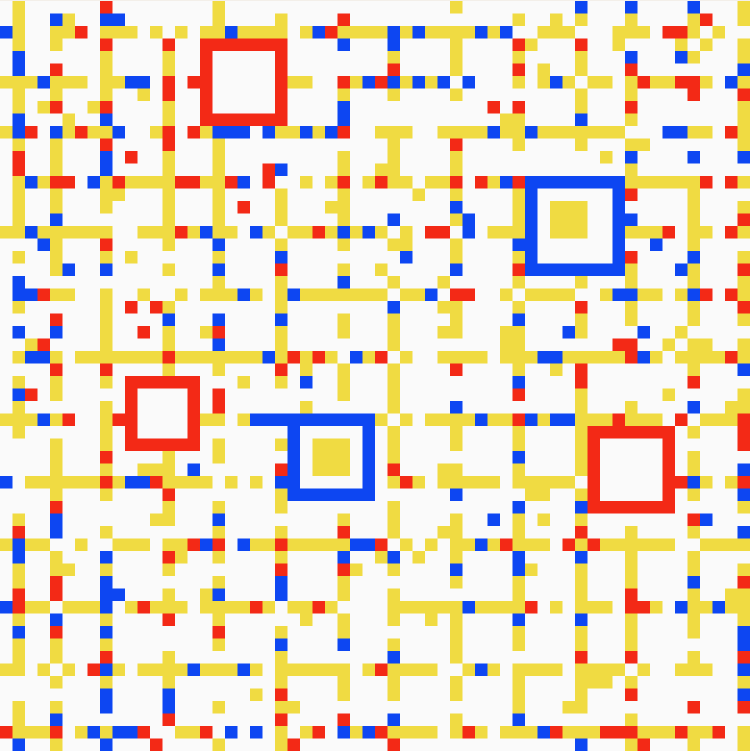

# E2. Broadway Boogie-Woogie

Indirizzo pubblico del lavoro: https://jacopo-0-4.github.io/aa2627-tad-es/es2/

Lo sketch rielabora la composizione come un mosaico di tessere colorate su fondo bianco. La terna iniziale è giallo, rosso e blu; premi `J` per sostituirla con tre colori distinti scelti casualmente da una palette di tinte fisse. Premi `A` per aumentare il dettaglio dell'intero campo, `C` per ingrandire o rimpicciolire il campo in modo casuale, `O` per modificare casualmente la dimensione dei quadratini colorati al primo O della sequenza e per spostarli in altre posizioni al secondo O; queste modifiche coinvolgono anche i quadratini circostanti. Premi `P` per ruotare il campo in senso orario di un angolo casuale. Quando il campo si rimpicciolisce o ruota, prosegue oltre i bordi con nuovi quadratini generati secondo la stessa regola cromatica. Dentro il canvas compare una sequenza delle lettere di `JACOPO`: dopo tre combinazioni mescolate appare `JACOPO`, poi il ciclo ricomincia. Va digitata nell'ordine mostrato e completarla nasconde il messaggio; dopo aver completato la sequenza, cliccando il canvas la composizione torna allo stato iniziale e compare una nuova sequenza.

`preview.png` mostra una variante rappresentativa dello sketch.
